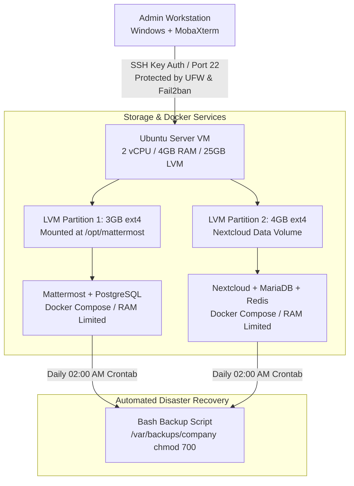

# 🐧 Self-Hosted Enterprise Collaboration & Storage Server (Linux Home Lab)

> **TL;DR (Quick Summary):** Provisioned and hardened an **Ubuntu Server** designed to support internal communication and file storage for a 100-person SME. Implemented **LVM dynamic storage partitioning**, **Docker Compose** microservices (**Mattermost** & **Nextcloud**), **UFW/Fail2ban** security hardening, and **automated Bash/Crontab backup pipelines**.

## 🏗️ Server & Service Architecture

## 🛠️ Key Infrastructure & DevOps Skills Demonstrated

### 1. Linux Storage Management (LVM) & System Provisioning
* **Dynamic Disk Expansion:** Expanded the root logical volume from `11.5GB` to `15GB` online without downtime, retaining unallocated VG pool capacity for future scaling.
* **Dedicated Service Volumes:** Carved out isolated LVM logical volumes (`3GB` for Mattermost, `4GB` for Nextcloud), formatted as `ext4`, and configured persistent auto-mounting in `/etc/fstab` (verified via `mount -a`).

### 2. Containerized Enterprise Applications (Docker Compose)
* **Internal Messaging (Mattermost):** Deployed **Mattermost + PostgreSQL** via Docker Compose with VirtualBox port forwarding (`8065`) for team chat.
* **Enterprise Cloud Storage (Nextcloud):** Deployed **Nextcloud + MariaDB + Redis** stack for centralized departmental file sharing.
* **Resource Governance:** Configured strict memory limits (`mem_limit`) inside `.yml` files to prevent OOM (Out-Of-Memory) crashes on a 4GB RAM host.

### 3. Server Security Hardening
* **SSH Hardening:** Disabled password authentication and enforced **SSH Key-Based Authentication** via MobaXterm.
* **Firewall (UFW):** Applied default-deny inbound policies, whitelisting only SSH (`Port 22`) while permitting outbound traffic.
* **Intrusion Prevention (Fail2ban):** Configured Fail2ban with trusted subnet whitelisting (`127.0.0.1/8`, `10.0.2.0/24`) and automated IP banning after `3` failed login attempts within `10` minutes.

### 4. Automated Backup & Disaster Recovery
* **Secure Backup Vault:** Created a restricted backup directory (`/var/backups/company` with `chmod 700` permissions).
* **Scheduled Automation:** Wrote a custom **Bash backup script** scheduled via **Crontab** (`0 2 * * *`) to automatically dump both PostgreSQL & MariaDB databases and archive application data daily at 2:00 AM.

## 📂 Featured Configurations & Scripts
* 📜 **[Automated Database & File Backup Script (`backup.sh`)](./scripts/backup.sh)** — *Daily Crontab automation for PostgreSQL, MariaDB, and business volumes.*
* 🐳 **[Docker Compose Stack Configurations](./docker/)** — *Production-ready `.yml` templates with memory constraints.*

